# ReFood — Alimentação consciente, desperdício reduzido

O **ReFood** é uma plataforma que conecta mercados, restaurantes, padarias e feiras a consumidores interessados em adquirir alimentos excedentes ou próximos do vencimento por preços reduzidos, com retirada por QR Code em máquinas inteligentes (vending machines) espalhadas pela cidade.

Projeto da **Global Solution 2026/2 — CitizenTech** (FIAP), disciplina **Front-End Design Engineering**.

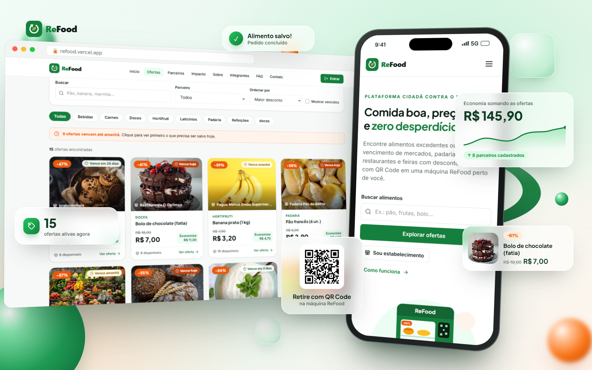

## Links

| | |
| --- | --- |
| Aplicação (Vercel) | https://refoodgs26.vercel.app/ |
| Repositório (GitHub) | https://github.com/Rochagx/ReFood_GS_2026- |
| API Java (Render) | https://refood-cdeg.onrender.com |
| Documentação da API | https://refood-cdeg.onrender.com/swagger-ui/index.html |
| Protótipo (Figma) | https://www.figma.com/design/KoYMvoZNKaJrCyX71RVbT5/ReFood-%E2%80%94-GS-2026--Telas-?node-id=0-1&t=i4UmeHKqcIhcuavp-1 |
| Vídeo (Google Drive) | https://drive.google.com/file/d/1e-8VNM-UK9X_0aIlXXmeFaBstTcE0cFO/view?usp=sharing |

## Objetivo

Reduzir o desperdício alimentar, incentivar o consumo consciente e oferecer alimentos de qualidade a preços mais acessíveis, usando a tecnologia como ferramenta de impacto social e sustentabilidade.

## Funcionalidades

| Página | Rota | Integração com a API |
| --- | --- | --- |
| Início | `/` | GET `/produto`, GET `/estabelecimento` (ofertas em destaque) |
| Ofertas | `/ofertas` | GET `/produto` com busca, filtro por categoria e ordenação |
| Detalhe da oferta | `/ofertas/:id` | GET `/produto/{id}`, GET `/estabelecimento/{id}`, **POST `/pedido`** |
| Parceiros | `/parceiros` | GET `/estabelecimento` |
| Detalhe do parceiro | `/parceiros/:id` | GET `/estabelecimento/{id}`, GET `/produto/estabelecimento/{id}` |
| Entrar / Criar conta | `/entrar` | GET `/usuario`, **POST `/usuario`** |
| Meus pedidos | `/pedidos` | GET `/pedido/usuario/{id}`, GET `/pagamento` |
| Detalhe do pedido | `/pedidos/:id` | GET `/pedido/{id}`, **POST `/pagamento`**, **PATCH `/pedido/{id}/concluir`** |
| Painel do parceiro | `/painel` | **POST/PUT `/estabelecimento`**, **POST/PUT/DELETE `/produto`**, GET/PATCH pedidos |
| Impacto | `/impacto` | GET `/pedido`, `/produto`, `/estabelecimento` (indicadores calculados) |
| Sobre, Integrantes, FAQ, Contato | `/sobre`, `/integrantes`, `/faq`, `/contato` | Institucionais (Contato com formulário validado) |

Todas as telas que consomem a API mostram **carregando**, **erro** (com botão “tentar de novo”) e **ausência de dados**.

## Design no Figma

As telas foram prototipadas no Figma antes do código: 15 telas desktop (1440 px) e 8 telas mobile (390 px).
[Abrir o arquivo no Figma](https://www.figma.com/design/KoYMvoZNKaJrCyX71RVbT5/ReFood-%E2%80%94-GS-2026--Telas-?node-id=0-1&t=i4UmeHKqcIhcuavp-1)

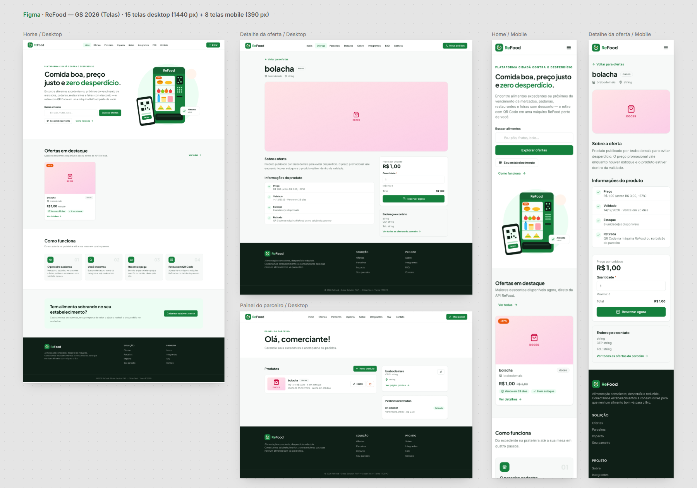

## Telas

### Versão mobile (390 px)
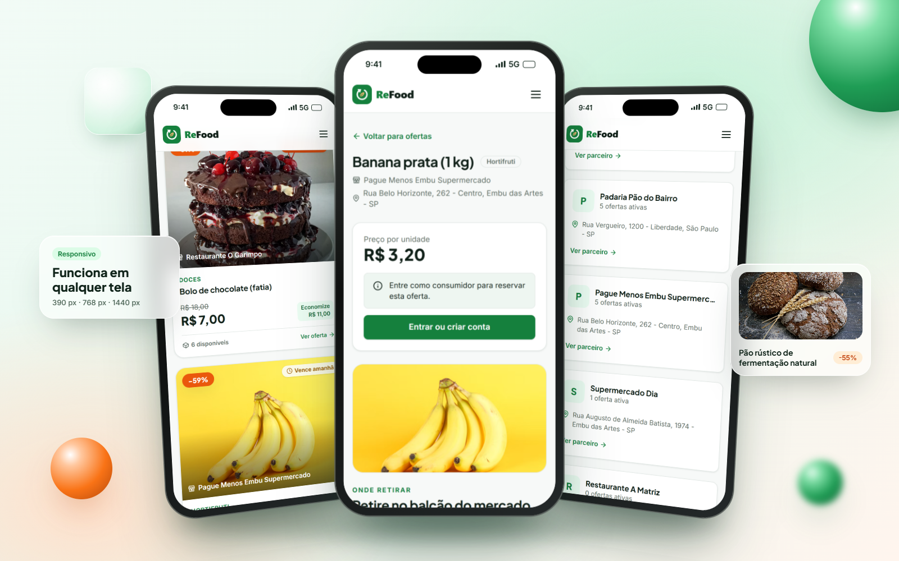

### Início
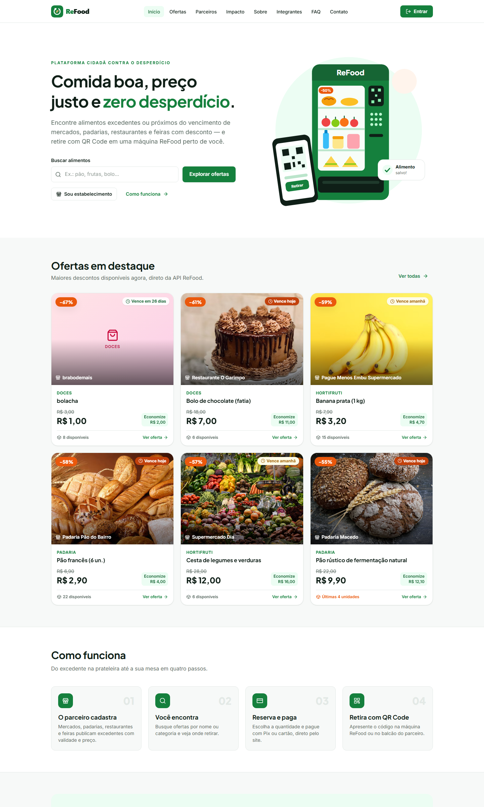

### Ofertas
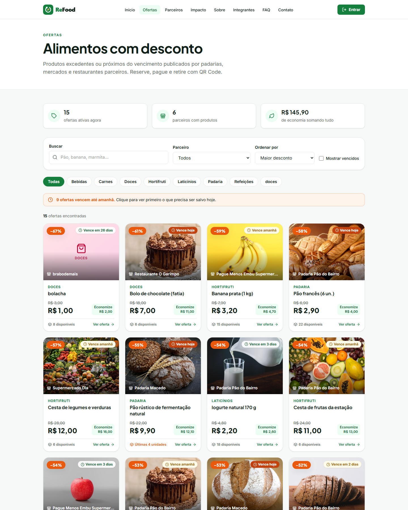

### Detalhe da oferta e onde retirar
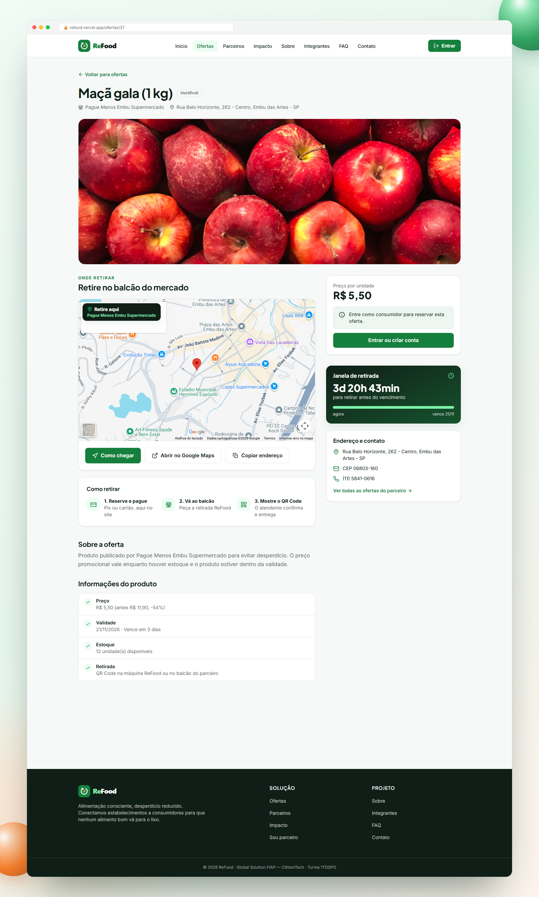

### Parceiros
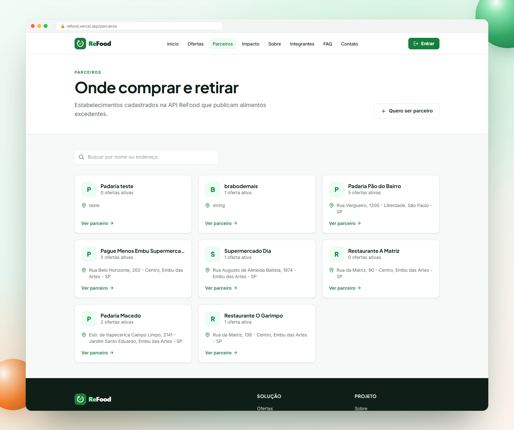

### Detalhe do parceiro
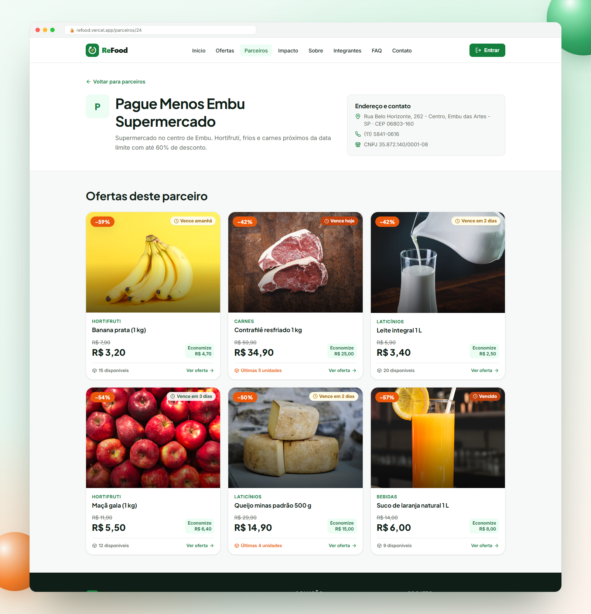

### Impacto
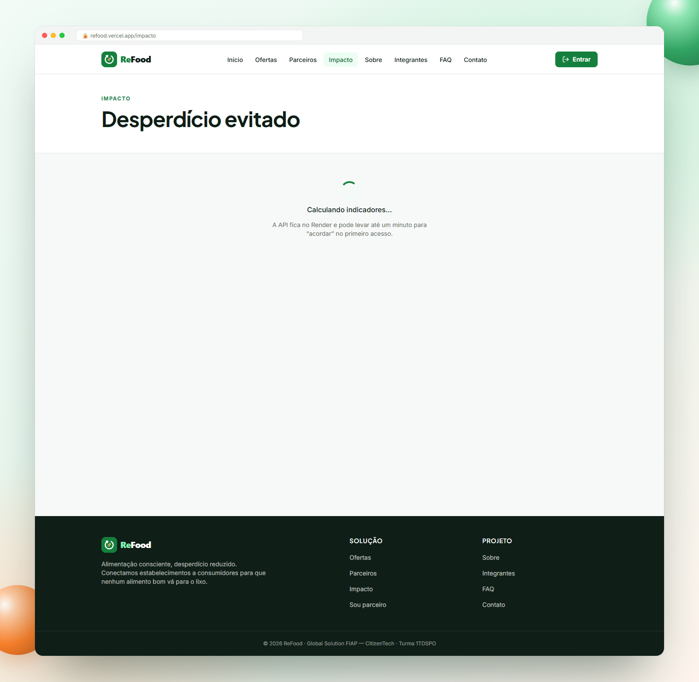

### Entrar / criar perfil
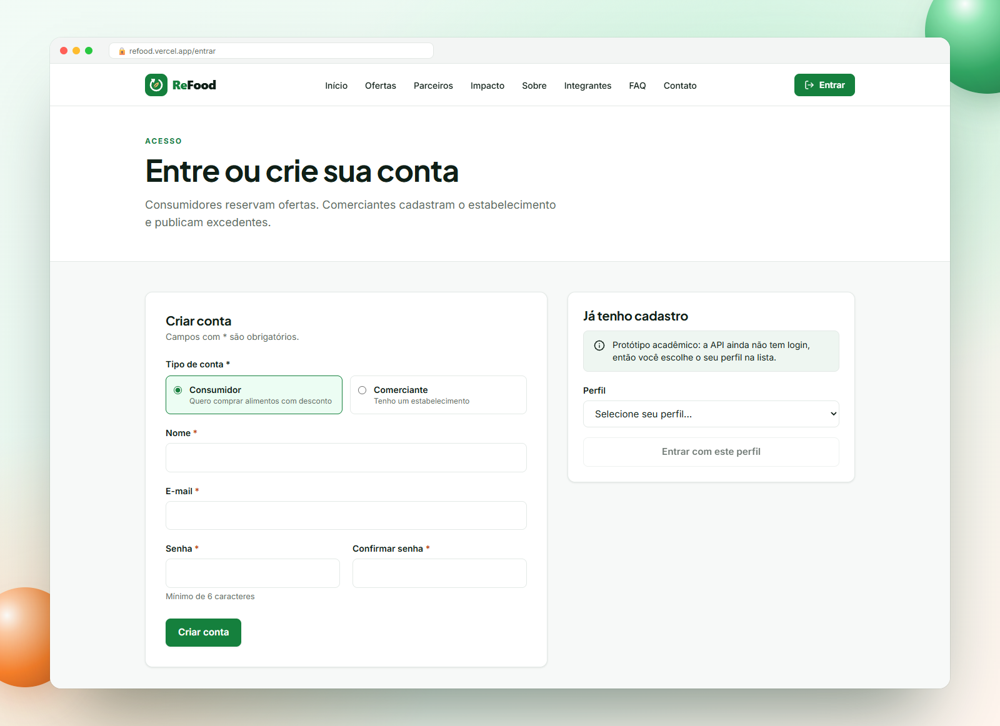

### Integrantes
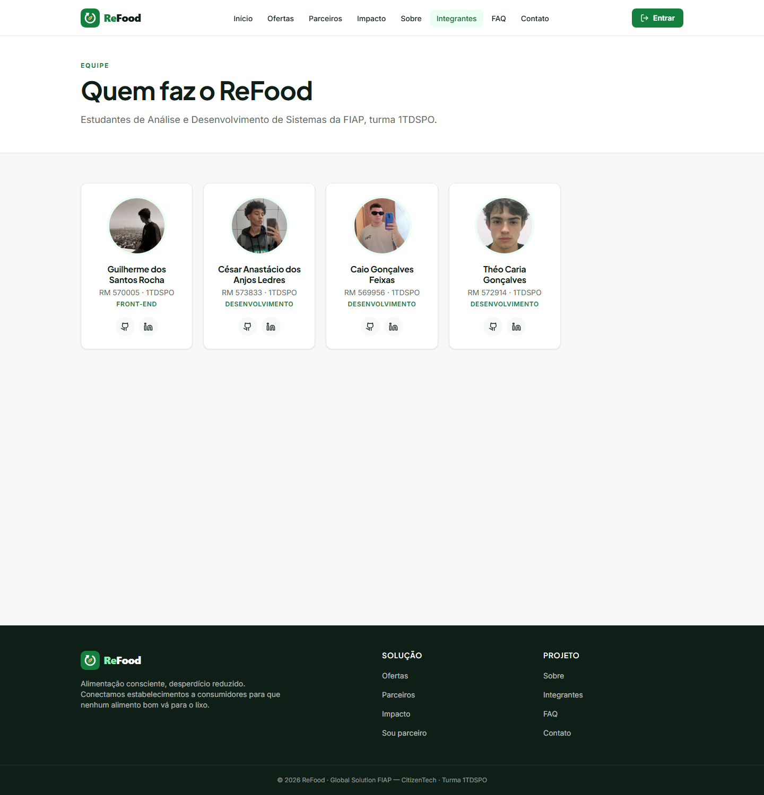

## Tecnologias

| Tecnologia | Uso |
| --- | --- |
| React 18 | Componentes, hooks (`useState`, `useEffect`, `useContext`) |
| Vite | Servidor de desenvolvimento, build e proxy da API |
| TypeScript | Tipagem de props, estados e respostas da API |
| React Router | Rotas estáticas e com parâmetro (`useParams`, `useNavigate`, `useSearchParams`) |
| Tailwind CSS 4 | Estilização e responsividade (mobile 390, tablet 768, desktop 1440) |
| Fetch API | Todas as requisições HTTP (sem Axios) |
| Context API + localStorage | Perfil ativo (consumidor/comerciante) |
| Vercel | Deploy do front-end |

## Estrutura de pastas

```
src/
├── assets/        # logo e fotos dos integrantes
├── components/    # componentes reutilizáveis (Button, ProdutoCard, Campo, Alerta, Estados, formulários...)
├── context/       # SessaoContext (perfil ativo)
├── hooks/         # useApi (loading/erro/dados) e useDocumentMeta
├── lib/           # formatação, validações e classes Tailwind reutilizadas
├── pages/         # uma página por rota
├── services/      # api.ts — todas as chamadas fetch para a API Java
├── types/         # api.ts — interfaces dos dados da API
├── App.tsx        # rotas
└── main.tsx
```

## Como executar

Pré-requisito: [Node.js](https://nodejs.org/) 18 ou superior.

```bash
git clone https://github.com/Rochagx/ReFood_GS_2026-.git
cd ReFood_GS_2026-
npm install
npm run dev
```

Abra `http://localhost:5173`.

> A API está no plano gratuito do Render: o primeiro acesso pode levar cerca de 1 minuto até ela “acordar”.

### Scripts

| Comando | Descrição |
| --- | --- |
| `npm run dev` | Ambiente de desenvolvimento |
| `npm run build` | Checagem de tipos + build de produção |
| `npm run preview` | Testa o build localmente |

## Integrantes

| Nome | RM | GitHub |
| --- | --- | --- |
| Guilherme dos Santos Rocha | 570005 | [Rochagx](https://github.com/Rochagx) |
| Giovanni Della Crucce Azevedo Santana | 572752 | [giovannidcas](https://github.com/giovannidcas) |
| César Anastácio dos Anjos Ledres | 573833 | [cesarledres](https://github.com/cesarledres) |
| Caio Gonçalves Feixas | 569956 | [Caiofeixas](https://github.com/Caiofeixas) |
| Théo Caria Gonçalves | 572914 | [theo4321](https://github.com/theo4321) |

Turma 1TDSPO — FIAP.

## Contato

Dúvidas sobre o projeto: abra uma *issue* no repositório ou use a página [Contato](https://refoodgs26.vercel.app/contato).
